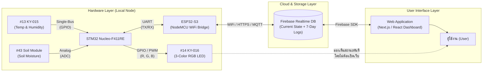
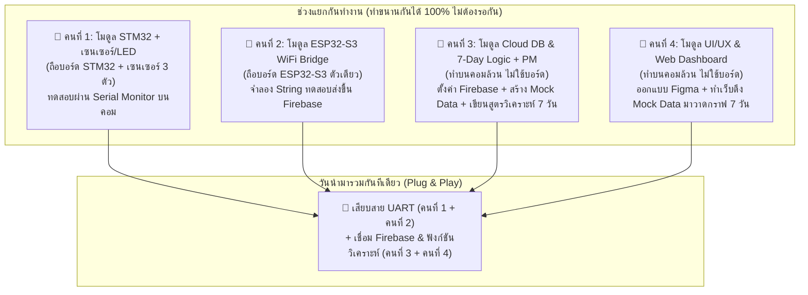

# Smart Plant Care & 7-Day Climate Analyzer (ระบบดูแลต้นไม้อัจฉริยะพร้อมวิเคราะห์ข้อมูลย้อนหลัง 7 วัน)

**รายวิชา:** 2110366 Embedded System Laboratory (Final Project, Fall 2026)  
**ภาควิชาวิศวกรรมคอมพิวเตอร์ คณะวิศวกรรมศาสตร์ จุฬาลงกรณ์มหาวิทยาลัย**

---

## สารบัญ (Table of Contents)
1. [บทนำและรายละเอียดโปรเจกต์ (Project Description)](#1-บทนำและรายละเอียดโปรเจกต์-project-description)
2. [วัตถุประสงค์ (Objectives)](#2-วัตถุประสงค์-objectives)
3. [อุปกรณ์และเซนเซอร์ที่ใช้ (Devices, Sensors & Actuators)](#3-อุปกรณ์และเซนเซอร์ที่ใช้-devices-sensors--actuators)
4. [สถาปัตยกรรมระบบและการทำงาน (System Architecture & Operation)](#4-สถาปัตยกรรมระบบและการทำงาน-system-architecture--operation)
5. [เกณฑ์การตัดสินใจและไฟแจ้งเตือนสถานะ LED (Decision Logic & LED Status)](#5-เกณฑ์การตัดสินใจและไฟแจ้งเตือนสถานะ-led-decision-logic--led-status)
6. [โครงสร้างฐานข้อมูลและโปรโตคอล (Database Design & Communication Protocol)](#6-โครงสร้างฐานข้อมูลและโปรโตคอล-database-design--communication-protocol)
7. [การออกแบบเว็บไซต์ (Website Features & UI/UX)](#7-การออกแบบเว็บไซต์-website-features--uiux)
8. [การแบ่งหน้าที่ความรับผิดชอบของสมาชิกทั้ง 4 คนแบบแยกทำอิสระ (Modular & Independent Roles)](#8-การแบ่งหน้าที่ความรับผิดชอบของสมาชิกทั้ง-4-คนแบบแยกทำอิสระ-modular--independent-roles)
9. [แผนการดำเนินงานและขั้นตอนการรวมงาน (Parallel Timeline & Integration Plan)](#9-แผนการดำเนินงานและขั้นตอนการรวมงาน-parallel-timeline--integration-plan)

---

## 1. บทนำและรายละเอียดโปรเจกต์ (Project Description)

โปรเจกต์ **Smart Plant Care & 7-Day Climate Analyzer** เป็นระบบ IoT สำหรับติดตามสุขภาพของต้นไม้และสภาพแวดล้อมโดยรอบแบบอัตโนมัติ เพื่อแก้ปัญหาการดูแลต้นไม้ไม่สม่ำเสมอ เช่น ลืมรดน้ำ รดน้ำมากเกินไป หรือวางต้นไม้ตากแดดจัดเป็นเวลานานจนเกิดความเครียดจากความร้อน (Heat Stress)

จุดเด่นของระบบนี้คือ **ไม่ได้พิจารณาเพียงแค่ค่าความชื้นดินหรืออุณหภูมิ ณ วินาทีปัจจุบันเท่านั้น** แต่ยังทำการ **บันทึกและวิเคราะห์ข้อมูลความชื้นในดิน อุณหภูมิ และความชื้นสัมพัทธ์ในอากาศย้อนหลังเป็นเวลา 1 สัปดาห์ (7 วัน)** เพื่อนำแนวโน้ม (Trend) เช่น อัตราการแห้งของดิน (Soil Drying Rate) และชั่วโมงสะสมที่ต้นไม้เผชิญความร้อนสูง (Accumulated Heat Stress) มาประมวลผลร่วมกับค่าปัจจุบัน เพื่อแนะนำผู้ใช้งานว่า **"ตอนนี้ควรรดน้ำหรือไม่"** และ **"ควรยกต้นไม้ออกจากแดดเข้าที่ร่มหรือไม่"**

นอกจากนี้ ระบบยังออกแบบให้ใช้งานสะดวกในชีวิตประจำวันด้วยช่องทางการแจ้งเตือน 2 รูปแบบ:
1. **การแจ้งเตือนหน้างานผ่านไฟ LED 3 สี (KY-016):** แสดงสีตามสิ่งที่ผู้ปลูกควรทำในขณะนั้นทันทีเมื่อเดินผ่านกระถางต้นไม้ โดยไม่จำเป็นต้องเปิดเข้าเว็บไซต์ตลอดเวลา
2. **การแสดงผลเชิงลึกผ่าน Web Application:** แสดงสถานะปัจจุบันของพืช (ความชื้นดิน, อุณหภูมิ, ความชื้นอากาศ), คำแนะนำการดูแล, ค่าต่ำสุด/สูงสุด/ค่าเฉลี่ย และกราฟข้อมูลย้อนหลัง 7 วัน

---

## 2. วัตถุประสงค์ (Objectives)

1. **ลดความเสี่ยงที่พืชจะเฉาตายหรือรากเน่า:** จากการวิเคราะห์ความชื้นในดินร่วมกับแนวโน้มการระเหยของน้ำตลอด 1 สัปดาห์ที่ผ่านมา ทำให้ทราบจังหวะที่ควรรดน้ำหรือควรงดรดน้ำได้อย่างแม่นยำ
2. **ป้องกันความเสียหายจากแสงแดดและความร้อนสะสม:** แจ้งเตือนให้ย้ายต้นไม้ออกจากแดดเมื่ออุณหภูมิสูงเกินเกณฑ์ หรือเมื่อต้นไม้สะสมความร้อนสูงต่อเนื่องหลายวันในรอบสัปดาห์
3. **เพิ่มความสะดวกด้วยสถานะไฟ LED หน้าเครื่อง:** ผู้ใช้สามารถดูสีของไฟ 3-Color LED (`KY-016`) ที่ตัวอุปกรณ์เพื่อรับรู้สถานะและสิ่งที่ต้องทำได้ทันทีโดยไม่ต้องเปิดหน้าเว็บทุกครั้ง
4. **สร้างระบบ Dashboard ติดตามผลระยะยาว:** มีเว็บไซต์สำหรับดูข้อมูลแบบ Real-time และดูกราฟสถิติย้อนหลัง 7 วันผ่านระบบ Cloud (Firebase)

---

## 3. อุปกรณ์และเซนเซอร์ที่ใช้ (Devices, Sensors & Actuators)

### 3.1 บอร์ดไมโครคอนโทรลเลอร์ (Microcontrollers)
1. **STM32 Nucleo-F411RE:** ทำหน้าที่เป็นศูนย์กลางในการอ่านค่าจากเซนเซอร์ทั้ง 2 ตัว แปลงหน่วยข้อมูล ประมวลผลเบื้องต้น ขับสัญญาณไฟ LED 3 สี และรับ-ส่งข้อมูลกับ ESP32-S3 ผ่าน UART
2. **ESP32-S3 (NodeMCU):** ทำหน้าที่เป็น WiFi Bridge เชื่อมต่อระหว่างบอร์ด STM32 กับระบบ Cloud (Firebase) เพื่อส่งข้อมูลขึ้นไปเก็บบันทึกย้อนหลัง 7 วัน และดึงผลการประมวลผล/คำสั่งกลับมาอัปเดตสถานะ

### 3.2 เซนเซอร์และอุปกรณ์แสดงผล (ตามรายการ Sensor & Actuator List)
| รหัสอุปกรณ์ | ชื่อโมดูล | ประเภท | การเชื่อมต่อกับ STM32 | หน้าที่การทำงานในโปรเจกต์ |
| :--- | :--- | :--- | :--- | :--- |
| **13** | **Temperature and humidity sensor module (KY-015)** | Sensor | Digital Single-Bus (GPIO) | วัดค่าอุณหภูมิแวดล้อม ($0^\circ\text{C} - 50^\circ\text{C}$) และความชื้นสัมพัทธ์ในอากาศ ($20\% - 90\%\text{ RH}$) เพื่อประเมินความร้อนจากแสงแดดและการคายน้ำ |
| **43** | **Soil module (Soil Moisture Sensor)** | Sensor | Analog Input (ADC 12-bit) | วัดค่าความชื้นในดินผ่านขา Analog (`AO`) แล้วแปลงค่าแรงดันไฟฟ้าเป็นเปอร์เซ็นต์ความชื้นในดิน ($0\% - 100\%$) |
| **14** | **3-color LED module (KY-016)** | Actuator | Digital Output / PWM (3 ขา R, G, B) | แสดงสีแจ้งเตือนสิ่งที่ผู้ใช้ควรทำในขณะนั้น (เช่น สีเขียว = ปกติ, สีน้ำเงิน = ควรรดน้ำ, สีเหลือง = ควรเอาออกจากแดด, สีแดง = ต้องรดน้ำและเอาออกจากแดดทันที) |

### 3.3 รายละเอียดทางเทคนิคและการแปลงค่าเซนเซอร์
* **Soil Moisture Module (`#43`):**
  * อ่านค่าผ่าน 12-bit ADC ของ STM32 (ค่าดิบอยู่ในช่วง `0` ถึง `4095`)
  * แปลงเป็นเปอร์เซ็นต์ความชื้นในดิน ($0\% - 100\%$) โดยเทียบค่าขณะอยู่ในอากาศแห้ง (`OpenAirReading`) และขณะจุ่มน้ำ (`WaterReading`):
    $$\text{SoilMoisture (\%)} = \text{map}(\text{ADC\_Value}, \text{OpenAirReading}, \text{WaterReading}, 0, 100)$$
* **Temperature & Humidity Module (`#13` KY-015 / DHT11):**
  * สื่อสารผ่านโปรโตคอล Single-Wire Serial ส่งข้อมูลครั้งละ 40 bits (`8-bit integral RH` + `8-bit decimal RH` + `8-bit integral Temp` + `8-bit decimal Temp` + `8-bit Checksum`)
* **3-Color LED Module (`#14` KY-016):**
  * โมดูล RGB LED แบบ Common Cathode (ขา `-` ต่อ GND, ขา `R`, `G`, `B` ต่อกับ GPIO/PWM ของ STM32) สามารถผสมสีได้จากการเปิด-ปิดขา R, G, B หรือปรับค่า Duty Cycle ของ PWM

---

## 4. สถาปัตยกรรมระบบและการทำงาน (System Architecture & Operation)



### ลำดับการทำงานของระบบ (System Operation Flow)
1. **การอ่านค่าเซนเซอร์ (Sensing):** บอร์ด `STM32` อ่านค่าความชื้นในดินจาก `Soil Module (#43)` ผ่าน ADC และอ่านค่าอุณหภูมิ/ความชื้นอากาศจาก `KY-015 (#13)` ตามรอบเวลาที่กำหนด (เช่น ทุกๆ 5 วินาทีสำหรับการแสดงผล Real-time)
2. **การประมวลผลและขับไฟ LED (Local & Trend Evaluation):**
   * `STM32` ประเมินค่าปัจจุบันร่วมกับสถานะแนวโน้ม 7 วันล่าสุดที่รับมาจาก `ESP32-S3`
   * `STM32` สั่งเปิดไฟ `3-Color LED (#14 KY-016)` ตามสถานะคำแนะนำทันที เพื่อให้ผู้ใช้เห็นหน้างานได้ตลอดเวลา
3. **การส่งข้อมูลระหว่างบอร์ด (UART Communication):** `STM32` จัดรูปแบบข้อมูลเป็น String Packet ส่งไปยัง `ESP32-S3` ผ่านพอร์ต UART
4. **การบันทึกข้อมูลย้อนหลัง 1 สัปดาห์ (Cloud Logging & 7-Day Retention):**
   * `ESP32-S3` อัปเดตค่าปัจจุบันไปยัง collection `current_status` บน Firebase เพื่อให้หน้าเว็บแสดงผลแบบ Real-time
   * ทุกๆ ช่วงเวลาที่กำหนด (เช่น ทุก 15–60 นาที) ระบบจะบันทึก Snapshot ลงใน `history_logs` พร้อม Timestamp และตัดข้อมูลที่เก่าเกิน 7 วันออกโดยอัตโนมัติ (Rolling 7-Day Window)
5. **การแสดงผลบนเว็บไซต์ (Web Visualization):** เว็บไซต์ดึงข้อมูลทั้งสถานะปัจจุบันและข้อมูลย้อนหลัง 7 วันจาก Firebase มาคำนวณค่าสถิติ (Min, Max, Average, อัตราการลดลงของความชื้นดิน, ชั่วโมงความร้อนสะสม) และแสดงผลเป็นกราฟพร้อมคำแนะนำการดูแลต้นไม้

---

## 5. เกณฑ์การตัดสินใจและไฟแจ้งเตือนสถานะ LED (Decision Logic & LED Status)

### 5.1 เกณฑ์การวิเคราะห์ข้อมูลปัจจุบันร่วมกับข้อมูลย้อนหลัง 7 วัน
ระบบแบ่งการวิเคราะห์ออกเป็น 2 มิติหลัก คือ **การรดน้ำ (Watering Decision)** และ **การหลบแดด/ความร้อน (Sunlight & Heat Decision)**:

1. **การวิเคราะห์ว่าควรรดน้ำหรือไม่ (Watering Analysis):**
   * **เกณฑ์ปกติ (Optimal Soil Moisture):** ความชื้นในดินอยู่ระหว่าง `35% - 75%`
   * **ควรรดน้ำ (Needs Watering):**
     * **กรณีที่ 1 (ค่าปัจจุบันต่ำ):** ความชื้นในดินปัจจุบัน `< 35%`
     * **กรณีที่ 2 (วิเคราะห์แนวโน้ม 7 วัน - Fast Drying Trend):** ความชื้นดินอยู่ที่ `35% - 42%` แต่อัตราการลดลงของความชื้นดินในรอบ 24–48 ชั่วโมงที่ผ่านมาเร็วกว่าค่าเฉลี่ย 7 วันเกิน 1.5 เท่า (ดินกำลังแห้งอย่างรวดเร็วจากอากาศร้อน) ระบบจะเตือนให้รดน้ำล่วงหน้าก่อนดินแห้งสนิท
   * **น้ำมากเกินไป / งดรดน้ำ (Overwatered Warning):** ความชื้นดิน `> 80%` ต่อเนื่องเกิน 48 ชั่วโมงในรอบสัปดาห์ เสี่ยงต่อโรครากเน่า

2. **การวิเคราะห์ว่าควรเอาต้นไม้ออกจากแดดหรือไม่ (Sunlight / Heat Stress Analysis):**
   * **เกณฑ์ปกติ (Optimal Temperature):** อุณหภูมิอยู่ระหว่าง `18°C - 32°C` และความชื้นสัมพัทธ์ `40% - 80% RH`
   * **ควรเอาต้นไม้ออกจากแดด (Move Out of Direct Sunlight):**
     * **กรณีที่ 1 (ความร้อนปัจจุบันสูง):** อุณหภูมิปัจจุบัน `> 34°C` (หรือ `> 32°C` ร่วมกับความชื้นอากาศต่ำ `< 40% RH` ซึ่งทำให้พืชคายน้ำไม่ทัน)
     * **กรณีที่ 2 (ความร้อนสะสมในรอบ 7 วันสูง - 7-Day Heat Stress):** อุณหภูมิปัจจุบันเริ่มสูง (`32°C - 34°C`) และเมื่อดูข้อมูลย้อนหลัง 7 วันพบว่าต้นไม้ได้รับอุณหภูมิเกิน `33°C` สะสมเกินกว่าเกณฑ์ที่กำหนด (เช่น เกิน 12 ชั่วโมงในสัปดาห์นี้) ระบบจะสั่งเตือนให้ย้ายเข้าที่ร่มเพื่อฟื้นฟูต้นไม้

### 5.2 ตารางสถานะไฟ 3-Color LED (`#14 KY-016`)
เพื่อไม่ให้ผู้ใช้ต้องเปิดเว็บไซต์ตลอดเวลา โมดูล `KY-016` จะแสดงสีตามการผสมไฟ R, G, B ดังนี้:

| สีของไฟ LED (KY-016) | ค่าพิน (R, G, B) | สถานะของพืช | สิ่งที่ควรทำตอนนี้ (Action Required) |
| :--- | :---: | :--- | :--- |
| 🟢 **สีเขียว (Green)** | `(0, 1, 0)` | **ปกติ (Healthy / Optimal)** | ต้นไม้สมบูรณ์ดี ไม่ต้องรดน้ำและไม่ต้องย้ายที่ |
| 🔵 **สีน้ำเงิน/ฟ้า (Blue/Cyan)** | `(0, 0, 1)` หรือ `(0, 1, 1)` | **ดินแห้ง (Needs Water)** | **ควรรดน้ำต้นไม้ตอนนี้** (อุณหภูมิอยู่ในเกณฑ์ปกติ) |
| 🟡 **สีเหลือง (Yellow)** | `(1, 1, 0)` | **ร้อนเกินไป (Too Hot / Heat Stress)** | **ควรยกต้นไม้ออกจากแดด/เข้าที่ร่ม** (ความชื้นดินยังเพียงพอ) |
| 🔴 **สีแดง (Red / Blinking Red)** | `(1, 0, 0)` | **วิกฤต (Critical: Dry & Hot)** | **ควรรดน้ำทันที และ ย้ายต้นไม้ออกจากแดดด่วน!** |
| 🟣 **สีม่วง (Purple)** | `(1, 0, 1)` | **ดินแฉะเกินไป (Overwatered)** | **งดรดน้ำ** และวางในที่อากาศถ่ายเทสะดวก |

---

## 6. โครงสร้างฐานข้อมูลและโปรโตคอล (Database Design & Communication Protocol)

### 6.1 โปรโตคอล UART ระหว่าง STM32 และ ESP32-S3
* **STM32 -> ESP32-S3 (ส่งค่าเซนเซอร์และสถานะ):**
  * Format: `"T%dH%dS%dL%dE\r\n"`
  * ตัวอย่าง: `"T31H65S48L0E\r\n"`
    * `T31` = Temperature $31^\circ\text{C}$
    * `H65` = Air Humidity $65\%\text{ RH}$
    * `S48` = Soil Moisture $48\%$
    * `L0` = Current Local Status Code (`0` = Green/Normal, `1` = Blue/Water, `2` = Yellow/Shade, `3` = Red/Both, `4` = Purple/Overwatered)
    * `E` = End of packet
* **ESP32-S3 -> STM32 (ส่งผลการวิเคราะห์ Trend 7 วันกลับมาปรับไฟ LED):**
  * Format: `"C%d\r\n"` (เช่น `"C2\r\n"` เพื่อสั่งให้ STM32 อัปเดตไฟ LED เป็นสถานะ `2` เมื่อพบว่าความร้อนสะสมในรอบ 7 วันเกินเกณฑ์)

### 6.2 โครงสร้างฐานข้อมูล (Firebase Realtime Database Schema)
แบ่งออกเป็น 3 ส่วนหลัก เพื่อให้รองรับทั้งการแสดงผลทันทีและการวิเคราะห์ข้อมูลย้อนหลัง 1 สัปดาห์:

```json
{
  "current_status": {
    "temperature": 31.0,
    "humidity": 65.0,
    "soil_moisture": 48.0,
    "led_status": "NORMAL",
    "recommend_water": false,
    "recommend_shade": false,
    "action_message": "สภาพแวดล้อมเหมาะสม ไม่ต้องดำเนินการใดๆ",
    "updated_at": 1763039820
  },
  "weekly_summary": {
    "temp_min": 24.5,
    "temp_max": 36.0,
    "temp_avg": 29.8,
    "soil_min": 28.0,
    "soil_max": 82.0,
    "soil_avg": 54.2,
    "soil_drying_rate_per_day": 14.5,
    "heat_stress_hours_7d": 6.5
  },
  "history_logs": {
    "2026-11-07_08-00": { "temp": 27.0, "hum": 70.0, "soil": 72.0, "timestamp": 1762477200 },
    "2026-11-07_09-00": { "temp": 29.5, "hum": 64.0, "soil": 69.0, "timestamp": 1762480800 }
  }
}
```

---

## 7. การออกแบบเว็บไซต์ (Website Features & UI/UX)

เว็บไซต์พัฒนาในรูปแบบ Single Page Application (เช่น ใช้ **Next.js / React** และ **TailwindCSS**) โดยมีส่วนประกอบหลัก 4 ส่วน:

1. **ส่วนแสดงคำแนะนำและสถานะไฟ LED ปัจจุบัน (Action & Status Banner):**
   * แสดงสีและข้อความตรงกับไฟ `KY-016` หน้าเครื่อง เช่น *"ควรรดน้ำตอนนี้ (ดินแห้งกว่าเกณฑ์)"* หรือ *"ควรย้ายต้นไม้เข้าที่ร่ม (อุณหภูมิสะสมสูง)"* พร้อมเวลาที่อัปเดตล่าสุด (Last Updated Timestamp)
2. **การ์ดแสดงค่าพารามิเตอร์ปัจจุบัน (Real-time Sensor Cards):**
   * แสดงค่า **ความชื้นในดิน (%)**, **อุณหภูมิ (°C)** และ **ความชื้นสัมพัทธ์ในอากาศ (%RH)** พร้อมค่า `Min`, `Max` และ `Average` ของสัปดาห์นี้
3. **กราฟแนวโน้มย้อนหลัง 7 วัน (7-Day Historical Charts & Analytics):**
   * กราฟเส้น (Line Chart) แสดงการเปลี่ยนแปลงของความชื้นดินและอุณหภูมิตลอด 7 วันที่ผ่านมา
   * แสดงข้อมูลวิเคราะห์เชิงลึก เช่น อัตราการลดลงของความชื้นดินเฉลี่ยต่อวัน และจำนวนชั่วโมงที่ต้นไม้โดนแดดจัดในสัปดาห์นี้
4. **คู่มืออธิบายเกณฑ์และสีไฟ LED (How to Tell Status / Guide):**
   * อธิบายความหมายของสีไฟ LED ทั้ง 5 สถานะ และช่วงค่าที่เหมาะสมของพืชแต่ละพารามิเตอร์

---

## 8. การแบ่งหน้าที่ความรับผิดชอบของสมาชิกทั้ง 4 คนแบบแยกทำอิสระ (Modular & Independent Roles)

เพื่อให้สมาชิกทั้ง 4 คนสามารถ **แยกย้ายไปทำงานของตนเองได้พร้อมกัน 100% โดยไม่ต้องรอบอร์ดหรือรอกันเป็นทอดๆ** และนำกลับมาประกอบรวมกันได้ในครั้งเดียว (Plug-and-Play Integration) โปรเจกต์นี้จึงแบ่งงานออกเป็น **4 โมดูลอิสระ** โดยตกลง **"ข้อตกลงการเชื่อมต่อกลาง (Interface Contracts)"** ล่วงหน้าตั้งแต่วันแรก ดังนี้:

### ข้อตกลงกลางก่อนแยกย้ายไปทำ (Interface Contracts)
1. **ข้อตกลงสาย UART (ระหว่าง คนที่ 1 กับ คนที่ 2):**
   * ใช้ Baud Rate `115200` (หรือ `9600`) ต่อสายเพียง 3 เส้น คือ `TX`, `RX`, `GND`
   * **STM32 ส่งให้ ESP32-S3:** รูปแบบ `"T<temp>H<hum>S<soil>L<led>E\n"` เช่น `"T31H65S48L0E\n"` ทุกๆ 5 วินาที
   * **ESP32-S3 ส่งกลับให้ STM32:** รูปแบบ `"C<status_0_to_4>\n"` เช่น `"C2\n"` เพื่อสั่งเปลี่ยนสีไฟ LED ตามผลวิเคราะห์ 7 วัน
2. **ข้อตกลงโครงสร้าง Firebase JSON (ระหว่าง คนที่ 2, คนที่ 3 และ คนที่ 4):**
   * ใช้ Path `/current_status` และ `/history_logs` ตามโครงสร้าง JSON ในหัวข้อที่ 6.2
   * มีข้อมูลจำลอง (Mock Data 7 วัน) อยู่ใน Firebase ตั้งแต่วันแรก เพื่อให้ฝั่งเว็บและฝั่งวิเคราะห์ข้อมูลทำงานจนเสร็จได้โดยไม่ต้องรอบอร์ดจริง



---

### สมาชิกคนที่ 1: โมดูลฮาร์ดแวร์และสมองกลฝังตัวฝั่งเซนเซอร์ (STM32 & Sensors/LED Module)
**ผู้รับผิดชอบ:** `[ชื่อ-นามสกุล สมาชิกคนที่ 1]` `[รหัสนิสิต]`  
**บทบาทในรายงาน (Role):** Embedded System Development (STM32 & Hardware Interfacing)  
**อุปกรณ์ที่ถือไปทำแยกเดี่ยว:** บอร์ด `STM32 Nucleo-F411RE` + เซนเซอร์ `KY-015 (#13)` + ไฟ `3-Color LED KY-016 (#14)` + `Soil Module (#43)`

#### งานที่ทำแยกเดี่ยวได้จนจบ 100%:
1. **ต่อวงจรและอ่านค่าเซนเซอร์:** ต่อวงจร `KY-015`, `Soil Module` และ `KY-016` เข้ากับบอร์ด `STM32` บน Breadboard พร้อมเขียนโค้ดภาษา C (STM32CubeIDE) อ่านค่าผ่าน ADC และ GPIO Single-Bus
2. **แปลงค่าและควบคุมไฟ LED 3 สี:** แปลงค่าความชื้นดินเป็นเปอร์เซ็นต์ ($0\% - 100\%$) และเขียนฟังก์ชันควบคุมพิน `R, G, B` ของโมดูล `KY-016` ให้แสดงสีทั้ง 5 สถานะ (เขียว, น้ำเงิน, เหลือง, แดง, ม่วง)
3. **รับ-ส่งข้อมูลตามมาตรฐาน UART:** จัดรูปแบบข้อมูลเป็น String `"T%dH%dS%dL%dE\n"` ส่งออกทางพอร์ต UART และเขียน Interrupt/Polling รอรับคำสั่ง `"C%d\n"` เพื่อเปลี่ยนสีไฟ LED

* **วิธีทดสอบด้วยตัวเอง (ไม่ต้องรอบอร์ด ESP32-S3 หรือเว็บ):** เสียบสาย USB ของ STM32 เข้าคอมพิวเตอร์ เปิด Serial Monitor เช็กว่าบอร์ดส่งข้อความ `"T31H65S48L0E"` ออกมาถูกต้อง และลองพิมพ์ `"C1"`, `"C2"`, `"C3"` ส่งกลับเข้าไปเพื่อดูว่าไฟ LED `KY-016` เปลี่ยนสีตามคำสั่งได้ครบทุกสี
* **สิ่งที่นำมาประกอบวันรวมงาน:** ยกบอร์ด STM32 ที่ต่อเซนเซอร์ครบแล้ว มาเสียบสาย `TX`, `RX`, `GND` เข้ากับบอร์ด ESP32-S3 ของคนที่ 2

---

### สมาชิกคนที่ 2: โมดูลเชื่อมต่ออินเทอร์เน็ตและเกตเวย์ (ESP32-S3 IoT Bridge Module)
**ผู้รับผิดชอบ:** `[ชื่อ-นามสกุล สมาชิกคนที่ 2]` `[รหัสนิสิต]`  
**บทบาทในรายงาน (Role):** System Architecture & Embedded IoT Gateway Developer (ESP32-S3)  
**อุปกรณ์ที่ถือไปทำแยกเดี่ยว:** บอร์ด `ESP32-S3 (NodeMCU)` เพียงบอร์ดเดียว (ไม่ต้องใช้เซนเซอร์และไม่ต้องรอบอร์ด STM32)

#### งานที่ทำแยกเดี่ยวได้จนจบ 100%:
1. **UART Packet Parser:** เขียนโค้ดบน `ESP32-S3` (Arduino IDE) เพื่อรอรับข้อความรูปแบบ `"T%dH%dS%dL%dE\n"` จาก UART แล้วแยกค่าตัวเลขออกมาเก็บในตัวแปร `temperature`, `humidity`, `soil_moisture` และ `led_status`
2. **WiFi & Firebase Cloud Sync:** เขียนโค้ดเชื่อมต่อ WiFi ดึงเวลาปัจจุบันจาก NTP Server แล้วส่งข้อมูลล่าสุดไปอัปเดตที่ `/current_status` บน Firebase และบันทึกข้อมูลรายชั่วโมงลง `/history_logs` สำหรับเก็บสถิติย้อนหลัง 7 วัน (พร้อมลบรายการที่เก่าเกิน 7 วันออกอัตโนมัติ)
3. **Command Feedback:** ดึงรหัสสถานะคำแนะนำจาก Firebase แล้วส่งข้อความ `"C%d\n"` กลับออกทางพอร์ต UART

* **วิธีทดสอบด้วยตัวเอง (ไม่ต้องรอบอร์ด STM32):** ใช้ฟังก์ชันจำลองข้อความขาเข้า (เช่น ป้อน `"T35H40S25L3E\n"` ผ่าน Serial Monitor ของคอมตัวเอง หรือตั้งตัวแปรสุ่มค่าในโค้ด) แล้วตรวจสอบว่าข้อมูลถูกส่งขึ้นไปแสดงบน Firebase ได้อย่างถูกต้อง
* **สิ่งที่นำมาประกอบวันรวมงาน:** ปิดโหมดจำลองค่า แล้วนำสาย UART (`RX`, `TX`, `GND`) มาเสียบเข้ากับบอร์ด STM32 ของคนที่ 1

---

### สมาชิกคนที่ 3: โมดูลฐานข้อมูล อัลกอริทึมวิเคราะห์ข้อมูล 7 วัน และบริหารโปรเจกต์ (Cloud DB, 7-Day Analytics & PM)
**ผู้รับผิดชอบ:** `[ชื่อ-นามสกุล สมาชิกคนที่ 3]` `[รหัสนิสิต]`  
**บทบาทในรายงาน (Role):** Data/Cloud Architect & Team Management (Project Manager)  
**อุปกรณ์ที่ใช้:** คอมพิวเตอร์ส่วนตัว (ทำงานฝั่ง Software, Cloud และการจัดการล้วน ไม่ต้องรอบอร์ด)

#### งานที่ทำแยกเดี่ยวได้จนจบ 100%:
1. **Firebase Setup & Mock Data Generator (ทำเป็นอันดับแรก):** สร้างโปรเจกต์ Firebase Realtime Database ตั้งค่าสิทธิ์การเข้าถึง และรันสคริปต์สร้าง **ข้อมูลจำลองย้อนหลัง 7 วัน (Mock Data)** ใส่ไว้ในฐานข้อมูลตั้งแต่วันแรก เพื่อให้คนที่ 2 และคนที่ 4 นำไปเชื่อมต่อได้ทันที
2. **7-Day Trend Analytics Module (`plantAnalyzer.ts`):** เขียนไฟล์ฟังก์ชันคำนวณแยกเป็นโมดูลอิสระ (Pure TypeScript/JavaScript Function) ที่รับข้อมูล `(current_status, history_logs)` เข้ามา แล้วคำนวณผลลัพธ์ส่งออกไปให้หน้าเว็บและระบบ ได้แก่:
   * ค่า `Min`, `Max`, `Average` ของความชื้นดินและอุณหภูมิในรอบ 7 วัน
   * อัตราการแห้งของดินเฉลี่ย (`soil_drying_rate`) และชั่วโมงสะสมที่ต้นไม้โดนความร้อนสูง (`heat_stress_hours`)
   * คำตัดสินว่าตอนนี้ **"ควรรดน้ำหรือไม่"**, **"ควรเอาต้นไม้ออกจากแดดหรือไม่"** และควรแสดงไฟ LED สีอะไร (`0–4`)
3. **Team Management & Integration:** จัดการ Git Repository, ส่ง Weekly Progress Report บน MCV, กำหนดตารางนัดรวมงาน และเตรียมสไลด์นำเสนอ 4 นาทีพร้อมจัดเล่มรายงาน

* **วิธีทดสอบด้วยตัวเอง (ไม่ต้องรอใคร):** รันทดสอบฟังก์ชัน `plantAnalyzer` กับชุดข้อมูลจำลอง 7 วันหลากหลายรูปแบบ (เช่น กรณีดินแห้งเร็วผิดปกติ, กรณีตากแดดร้อนสะสมหลายวัน, กรณีรดน้ำมากเกินไป) ว่าคืนค่าคำแนะนำถูกต้องครบทุกเงื่อนไข
* **สิ่งที่นำมาประกอบวันรวมงาน:** ส่งไฟล์ `firebaseConfig` และไฟล์โมดูล `plantAnalyzer.ts` ให้คนที่ 4 นำไป `import` ใส่ในโปรเจกต์เว็บไซต์

---

### สมาชิกคนที่ 4: โมดูลออกแบบและพัฒนาเว็บไซต์แสดงผล (UI/UX & Web Dashboard Module)
**ผู้รับผิดชอบ:** `[ชื่อ-นามสกุล สมาชิกคนที่ 4]` `[รหัสนิสิต]`  
**บทบาทในรายงาน (Role):** UI/UX Designer & Frontend Web Developer  
**อุปกรณ์ที่ใช้:** คอมพิวเตอร์ส่วนตัว (ทำบน Figma และเขียนเว็บล้วน ไม่ต้องรอบอร์ดจริง)

#### งานที่ทำแยกเดี่ยวได้จนจบ 100%:
1. **UI/UX Design (Figma):** ออกแบบหน้าเว็บ Dashboard แสดงสถานะของต้นไม้, แบนเนอร์บอกสิ่งที่ควรทำตอนนี้ (รดน้ำ / เอาออกจากแดด) ให้มีสีตรงกับไฟ LED `KY-016`, ส่วนแสดงกราฟย้อนหลัง 7 วัน และหน้าคู่มืออธิบายเกณฑ์วัด (`How to Tell Status`)
2. **Frontend Development (React / Next.js + TailwindCSS):**
   * พัฒนา Component การ์ดแสดงค่าความชื้นดิน (%), อุณหภูมิ (°C), ความชื้นอากาศ (%RH) และค่าต่ำสุด/สูงสุดของสัปดาห์
   * สร้างกราฟเส้น (Line Chart) แสดงแนวโน้มความชื้นดินและอุณหภูมิย้อนหลัง 7 วัน
   * เชื่อมต่อเว็บไซต์เข้ากับ Firebase เพื่อดึงข้อมูลมาแสดงผลแบบ Real-time
3. **Web Deployment:** นำเว็บไซต์ขึ้น Deploy บน Vercel ให้สามารถเข้าใช้งานผ่านลิงก์สาธารณะได้

* **วิธีทดสอบด้วยตัวเอง (ไม่ต้องรอบอร์ดของคนที่ 1 และ 2):** ใช้ข้อมูลจำลอง 7 วัน (Mock Data) บน Firebase ที่คนที่ 3 เตรียมไว้ให้ในการแสดงผลการ์ดและวาดกราฟ 7 วันจนหน้าเว็บทำงานได้สมบูรณ์ 100%
* **สิ่งที่นำมาประกอบวันรวมงาน:** `import` ฟังก์ชัน `plantAnalyzer` ของคนที่ 3 มาแสดงผลคำแนะนำ และเมื่อบอร์ดของคนที่ 1 และ 2 เสียบไฟทำงาน ข้อมูลจริงจากเซนเซอร์จะไหลขึ้นหน้าเว็บแทนที่ข้อมูลจำลองโดยอัตโนมัติ

---

## 9. แผนการดำเนินงานและขั้นตอนการรวมงาน (Parallel Timeline & Integration Plan)

| ช่วงเวลา | คนที่ 1 (STM32 + เซนเซอร์/LED) | คนที่ 2 (ESP32-S3 Bridge) | คนที่ 3 (Cloud + สูตรวิเคราะห์ 7 วัน + PM) | คนที่ 4 (UI/UX + Web Frontend) |
| :---: | :--- | :--- | :--- | :--- |
| **ขั้นที่ 1: ตกลงมาตรฐาน (วันแรก)** | ตกลงรูปแบบ String UART ร่วมกับคนที่ 2 และรับบอร์ด STM32 + เซนเซอร์ทั้ง 3 ตัวไปทำ | ตกลงรูปแบบ String UART และโครงสร้าง Firebase JSON ร่วมกับคนที่ 1 และ 3 พร้อมรับบอร์ด ESP32-S3 ไปทำ | สร้าง Firebase Database + อัปโหลด **Mock Data 7 วัน** แจกให้ทุกคนใช้ทดสอบ | ตกลงโครงสร้างข้อมูล JSON กับคนที่ 3 และเริ่มร่าง Wireframe บน Figma |
| **ขั้นที่ 2: แยกกันพัฒนา (ต่างคนต่างทำ)** | ต่อวงจรและเขียนโค้ด STM32 อ่านค่า `KY-015`, `Soil Module` และขับไฟ `KY-016` ทดสอบผ่าน Serial Monitor จนครบ | เขียนโค้ด ESP32-S3 หั่น String UART และส่งข้อมูลขึ้น Firebase ทดสอบด้วยข้อความจำลองจนผ่าน | เขียนฟังก์ชันคำนวณแนวโน้ม 7 วัน (`plantAnalyzer`) ทดสอบกับข้อมูลจำลอง และดูแลรายงานรายสัปดาห์ | ออกแบบ Figma ให้เสร็จ และเขียนเว็บ React/Next.js ดึง Mock Data จาก Firebase มาแสดงการ์ดและกราฟ 7 วัน |
| **ขั้นที่ 3: นำมารวมกันทีเดียว (Integration Day)** | นำบอร์ด STM32 มาเชื่อมสาย `TX, RX, GND` เข้ากับ ESP32-S3 ของคนที่ 2 | เชื่อมบอร์ดกับคนที่ 1 เพื่อส่งค่าเซนเซอร์จริงจาก STM32 ขึ้น Firebase | นำโมดูลวิเคราะห์ 7 วันผูกเข้ากับระบบและตรวจสอบความถูกต้องของข้อมูลทั้งระบบ | Deploy เว็บขึ้น Vercel และทดสอบแสดงผลค่าจริงที่ส่งมาจากบอร์ดแบบ Real-time |
| **ขั้นที่ 4: สรุปส่งงาน** | เขียนรายงานส่วน STM32 & Sensors (1+ หน้า) | เขียนรายงานส่วน ESP32-S3 & Gateway Architecture (1+ หน้า) | เขียนรายงานส่วน Cloud, 7-Day Logic & Project Management (1+ หน้า) + รวมเล่ม/สไลด์ | เขียนรายงานส่วน UI/UX & Web Development (1+ หน้า) |

